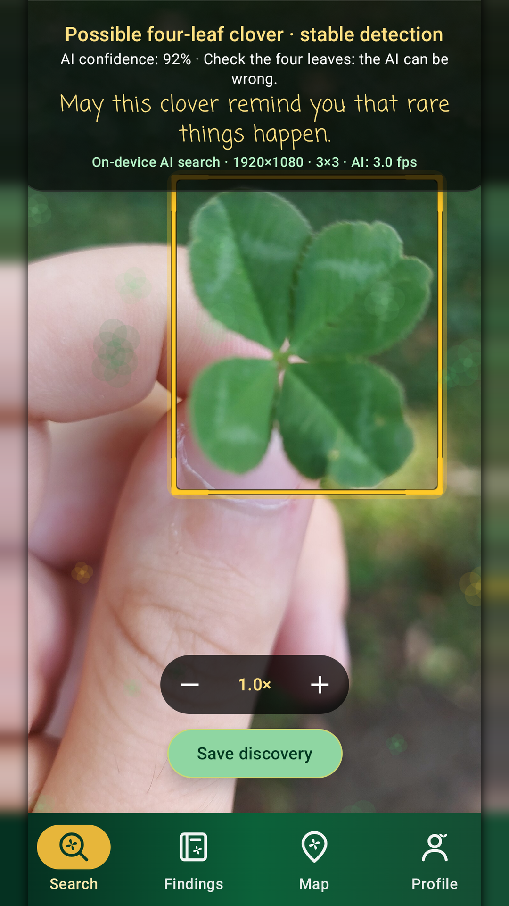
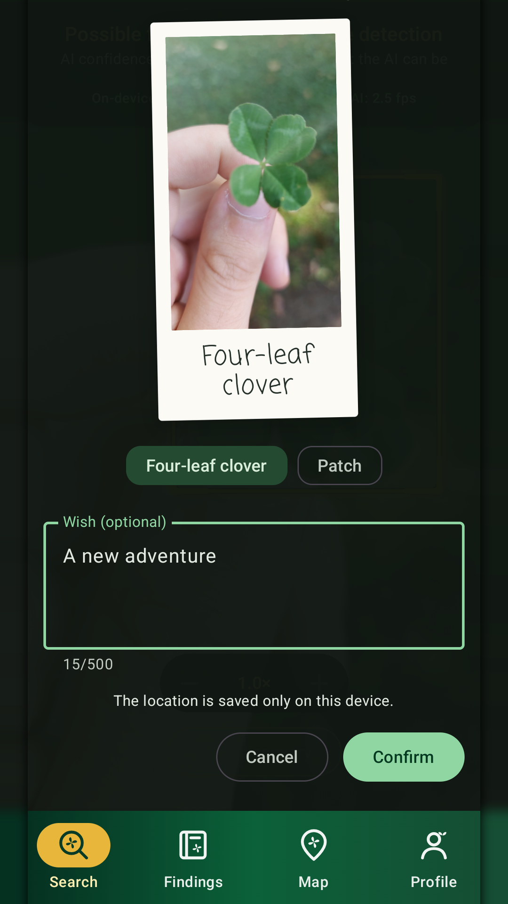
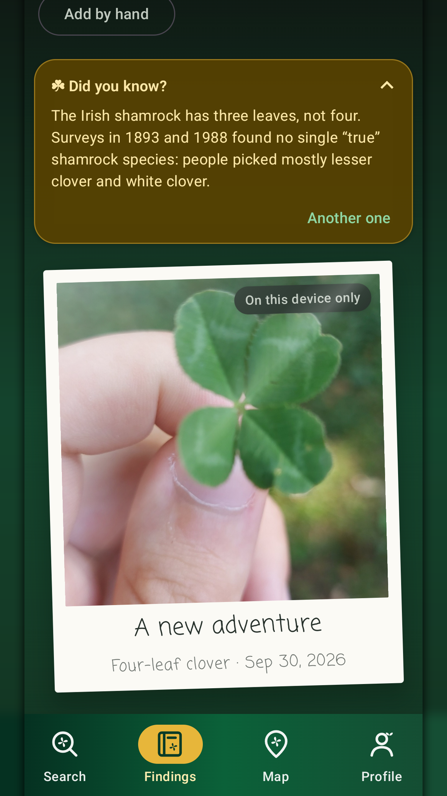
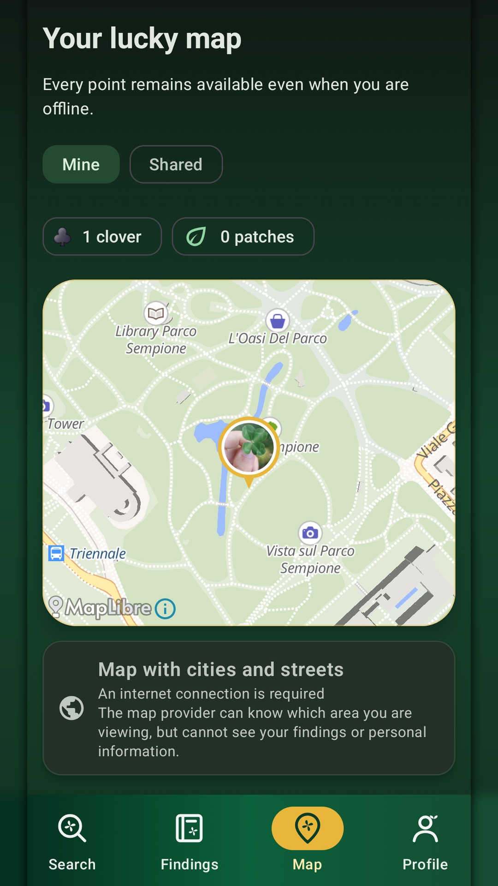

# Lucky Prospector

An Android app that helps you find four-leaf clovers. Point the camera at a patch of clover and an on-device AI highlights possible four-leaf ones.

  
  
  
  

<a href="https://play.google.com/store/apps/details?id=com.luckyprospector.app">Get it on Google Play</a>

## What it does

- **Live search:** the camera feed is analysed on the phone, tile by tile, and possible four-leaf clovers are highlighted once the detection is stable.
- **Private notebook:** photos, a wish and the exact location of each find stay on the device. No account is needed.
- **Optional shared map:** a find can be shared as a pin rounded to a cell of about 150 m, with an optional photo crop without GPS data. Other users never see who published it.
- **No ads, no analytics.** Camera frames never leave the phone.

## How it works

- Kotlin, Jetpack Compose, CameraX, Room, MapLibre (OpenFreeMap tiles).
- Detector: [YOLOX-Tiny](https://github.com/Megvii-BaseDetection/YOLOX), fine-tuned from COCO weights on three CC BY 4.0 clover datasets, exported to TensorFlow Lite with dynamic-range INT8 quantization (about 5.7 MB). It runs with LiteRT, on the GPU when available.
- Classes: `clover_3`, `clover_4`, `clover_5_plus`. Input 640×640 BGR, letterboxed; confidence 0.25, class-agnostic NMS at IoU 0.65.
- Shared map: Firebase Authentication (Google sign-in), Cloud Firestore and App Check (Play Integrity). The security rules are in [`firestore.rules`](firestore.rules).

Design notes (in Italian) are in [`docs/wiki`](docs/wiki).

## Building

Requirements: Android Studio with its bundled JDK, Android SDK 37.

The build needs a Firebase configuration, `app/google-services.json`, which is not in this repository. To build your own copy:

1. Create a Firebase project with an Android app whose package matches `applicationId` in `app/build.gradle.kts`. Change the package if you plan to distribute your build.
2. Enable Authentication (Google provider) and Cloud Firestore, and deploy `firestore.rules` and `firestore.indexes.json`.
3. Download `google-services.json` into `app/`.
4. Run `./gradlew assembleDebug`.

Debug builds use the App Check debug provider, which logs a token to register in the Firebase console.

Release signing reads an optional `keystore.properties` in the project root (`storeFile`, `storePassword`, `keyAlias`, `keyPassword`). Without it, release builds are unsigned.

Unit tests: `./gradlew testDebugUnitTest`.

## License

The source code is licensed under the [GNU General Public License v3.0](LICENSE). You may use, modify and redistribute it, including commercially, as long as derivative works are released under the same license with their source code.

The name **Lucky Prospector** and its logo are not covered by the license. See [TRADEMARKS.md](TRADEMARKS.md).

## Credits

The bundled model was trained with the YOLOX framework (Apache License 2.0) on these datasets, all licensed under [CC BY 4.0](https://creativecommons.org/licenses/by/4.0/):

- [Hunting for four-leaf clovers Dataset](https://universe.roboflow.com/adam-fonagy/hunting-for-four-leaf-clovers), Adam Fonagy, Roboflow Universe, 2023
- [4 leaf clover detect Dataset](https://universe.roboflow.com/test-ara07/4-leaf-clover-detect), "test", Roboflow Universe, 2024
- [clover Object Detection Dataset](https://universe.roboflow.com/clover-detection/clover-ucups), Clover Detection, Roboflow Universe, 2022

Hashes of the source manifests are recorded in [`dataset-provenance.json`](app/src/main/assets/models/lucky-prospector/dataset-provenance.json).

Map data © OpenStreetMap contributors, tiles by OpenFreeMap.

## Privacy

The privacy policy is in [`docs/privacy`](docs/privacy) and online at <https://emergentoremergency.github.io/lucky-prospector/>.
